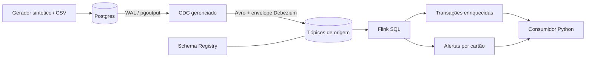

# Pagamentos em streaming

Este projeto acompanha uma transação desde o Postgres até o alerta de possível fraude. O caminho passa por **CDC Debezium, Confluent Cloud e Flink SQL**, e termina em um consumidor Python. No Flink, a transação recebe os dados da conta e entra na regra: três compras do mesmo cartão em até 60 segundos geram um alerta.

**O que já rodou:** na validação de 15/10/2026, a simulação local, os 20 testes e a configuração Terraform passaram. **A execução no Confluent Cloud ainda está pendente**, porque faltam as credenciais e um Postgres acessível ao conector. Para fechar a entrega, ainda preciso executar as camadas na nuvem e registrar o CDC, os resultados do Flink e o custo. Os testes locais cobrem parte do código, mas essa etapa de ponta a ponta depende do serviço.

Repositório: [Brunorsimas/Confluent-Cloud](https://github.com/Brunorsimas/Confluent-Cloud).
O repositório está com o nome original. Como a atividade pede um nome em minúsculas, falta renomeá-lo para `confluent-cloud` em Settings → General e atualizar o remote.

## O caminho do dado



| Camada | O que faz | Por que está aqui |
| --- | --- | --- |
| Fundação | `infra/` cria um ambiente isolado, Kafka Basic na AWS us-east-2, Schema Registry Essentials e um pool Flink de até 5 CFUs | Mantém o laboratório pequeno, com a infraestrutura descrita em código e um limite de capacidade definido |
| Contrato | Usa Avro no CDC e testa `FULL_TRANSITIVE` no subject real | Permite mudar o schema verificando se produtores e consumidores continuam compatíveis |
| Ingestão | Liga o `PostgresCdcSourceV2` a uma publication restrita, com `REPLICA IDENTITY FULL` | Captura as alterações confirmadas no WAL sem precisar consultar o banco em lotes |
| Processamento | `sql/flink/` trata o envelope das compras, acompanha as contas e aplica joins e `MATCH_RECOGNIZE` | Usa o horário da compra e evita contar um update de status como outra transação |
| Operação | Reúne consumo, verificação de resultados, teste de ACL, métricas, custos e limpeza | Ajuda a conferir o que rodou e a remover os recursos ao terminar |

O Terraform cria três identidades. A `payments-writer` escreve nos tópicos `payments.public.*` e nos tópicos de preview exigidos pelo conector. A `payments-reader` consome os dois tópicos de saída usando grupos `payments-reader-*`, sem permissão de escrita.

Já a `payments-operator` cuida da infraestrutura e do SQL, com `EnvironmentAdmin` no ambiente exclusivo do laboratório. Assim, o consumidor usa uma identidade própria, com acesso menor. Kafka, Schema Registry e Flink têm credenciais diferentes, que os scripts leem dos outputs em memória.

## O que já foi testado

Os 20 testes cobrem a regra de fraude, a evolução do contrato Avro, a validação dos CSVs e a leitura do `.env` sem executar seu conteúdo. A configuração também passou na validação do Terraform com o provider Confluent 2.91.0. As saídas completas estão em [evidence/local-validation.txt](evidence/local-validation.txt).

```text
$ python -m unittest discover -s tests -v
Ran 20 tests in 0.070s
OK

$ terraform -chdir=infra validate -no-color
Success! The configuration is valid.

$ python -m pip check
No broken requirements found.
```

A simulação local gerou 3 contas e 11 transações. Estes são os resultados do gerador e da validação dos arquivos:

```text
$ python -m pipeline simulate
accounts: 3
transactions: 11
expected_alerts:
  card-boundary:card-boundary-3
  card-burst:card-burst-3
  card-burst:card-burst-4

$ python -m pipeline validate-data
{"accounts": 3, "transactions": 11, "valid": true}
```

Encurtei a saída do gerador para facilitar a leitura; o JSON completo está em [evidence/simulation.json](evidence/simulation.json). O campo `expected_alerts` vem do script de referência em Python e indica os alertas esperados quando o cenário passar pelo Flink.

Para acompanhar o que falta na nuvem:

| Evidência de nuvem | Situação atual | Comando que a produz |
| --- | --- | --- |
| Ambiente, cluster e identidades | Não executado; falta acesso | `python -m pipeline foundation` |
| Aceitação/rejeição de schema no Registry | Não executado; testes Avro apenas locais | `python -m pipeline schema-test` |
| INSERT/UPDATE/DELETE e tombstone | Não executado; falta Postgres + conector | `python -m pipeline cdc-probe` |
| Jobs e resultados Flink | SQL preparado, sem validação pelo serviço | `python -m pipeline flink-status` e `python -m pipeline verify` |
| Consumo, ACL e métricas | Não executado | `consume`, `acl-test`, `metrics` |
| Cobrança real | Não disponível; nenhum recurso criado nesta execução | `costs` e exportação do Billing |

## Preparar a máquina

Para reproduzir o projeto, use Python 3.14, Git e Terraform 1.13.5. Os scripts conversam com o Cloud pelas APIs REST e pelo cliente Kafka oficial, então você pode seguir sem instalar a CLI Confluent. Depois de clonar, execute os comandos a partir da raiz do repositório.

```powershell
git clone https://github.com/Brunorsimas/Confluent-Cloud.git
cd Confluent-Cloud
python -m venv .venv
.\.venv\Scripts\Activate.ps1
python -m pip install -r requirements.txt
Copy-Item .env.example .env
python -m pipeline doctor
```

No Linux/macOS, a ativação é `source .venv/bin/activate` e a cópia do arquivo de configuração é `cp .env.example .env`. Se o PowerShell bloquear a ativação, dá para chamar `.\.venv\Scripts\python.exe` diretamente no lugar de `python`.

Se o Terraform estiver fora do PATH, informe o caminho do executável em `TERRAFORM`, no `.env`. As versões das dependências ficam fixadas em `requirements.lock`, e a do provider em `.terraform.lock.hcl`.

Preencha o `.env` na sua máquina com a Cloud API key e o secret. Essa identidade precisa ter permissão para criar o ambiente, as contas de serviço e os role bindings, e a conta Confluent precisa estar com faturamento ou créditos habilitados. Mantenha as chaves no arquivo local, fora do README e das issues.

## Preparar o Postgres

O conector gerenciado roda na nuvem, então o endereço do banco precisa ser acessível de lá. **O `localhost` da sua máquina não atende a esse requisito.** Para o laboratório, use Postgres 17 com TLS e permissão de replicação lógica. O banco, a rede e os certificados precisam estar preparados antes: o Terraform deste repositório cuida dos recursos Confluent.

Uma opção é criar pelo console AWS uma instância RDS PostgreSQL 17 em `us-east-2`, com banco inicial `payments` e credenciais próprias. Associe um parameter group PostgreSQL 17 com `rds.logical_replication=1` e reinicie a instância.

No security group, libere TCP 5432 apenas para seu IP e para os endereços de saída do conector naquela região. A rede e a subnet também precisam permitir a conexão; evite abrir o banco para `0.0.0.0/0`. Os detalhes estão nos [requisitos de rede dos conectores](https://docs.confluent.io/cloud/current/connectors/networking/index.html) e na [preparação de Postgres para CDC](https://docs.confluent.io/cloud/current/connectors/cc-postgresql-cdc-source-v2-debezium/cc-postgresql-cdc-source-v2-debezium.html).

Se você administra o Postgres, configure `wal_level=logical`, `max_replication_slots>=1`, `max_wal_senders>=1`, TLS e o acesso no `pg_hba.conf`, e reinicie o servidor. O usuário informado em `PGUSER` precisa poder criar as tabelas, a publication e a role de replicação. O comando `pg-init` reconhece RDS e usa `rds_replication`; no Postgres comum, usa `REPLICATION`.

Com o banco acessível, preencha no `.env`: `PGHOST`, `PGPORT`, `PGDATABASE`, `PGUSER`, `PGPASSWORD`, `PGSSLMODE=require`, `CDC_USER=payments_cdc` e uma senha própria em `CDC_PASSWORD`. Depois, crie as tabelas e confira a configuração:

```powershell
python -m pipeline pg-init
python -m pipeline pg-health
```

Se quiser começar estudando o banco na sua máquina, há um Compose opcional:

```powershell
docker compose up -d --wait
```

Nesse caso, configure `POSTGRES_PASSWORD`, `PGHOST=127.0.0.1`, `PGUSER=payments_admin`, `PGPASSWORD` igual a `POSTGRES_PASSWORD` e `PGSSLMODE=disable`. O Compose serve para os testes locais do banco. Para conectar o CDC no Cloud, volte às configurações do banco remoto: o Compose não prepara TLS público nem um túnel de acesso.

## Subir uma camada por vez

**1. Criar a infraestrutura.** Confira o plano antes do apply, pois essa etapa cria recursos com cobrança na nuvem.

```powershell
python -m pipeline tf init
python -m pipeline tf validate
python -m pipeline tf plan
python -m pipeline tf apply
python -m pipeline foundation
```

Por enquanto, o conector fica desabilitado. O apply mantém a confirmação do Terraform, sem `-auto-approve`, para você revisar os recursos antes de criá-los.

Guarde o state até terminar o laboratório: ele será necessário no destroy. Esse arquivo contém segredos mesmo quando os outputs estão marcados como `sensitive`, assim como os outputs brutos em `-json`. Ambos devem ficar fora do repositório público.

**2. Ligar o CDC e carregar os dados.** Comece com as tabelas vazias e ative o conector antes da carga. Assim, as transações passam pelo WAL como eventos `c`, na ordem de tempo do cenário.

```powershell
python -m pipeline tf plan -var=enable_connector=true
python -m pipeline tf apply -var=enable_connector=true
python -m pipeline connector-status
python -m pipeline simulate
python -m pipeline validate-data
python -m pipeline load
python -m pipeline cdc-probe
```

Espere o `connector-status` mostrar o conector e as tarefas em `RUNNING` antes de continuar. Se ainda estiver provisionando, aguarde um pouco e consulte de novo.

O `simulate` cria 3 contas e 11 transações, com cartões tokenizados, valores em centavos e timestamps UTC. Ele preserva arquivos existentes, então, se você já gerou a base localmente, basta reutilizá-la e pular esse comando. Para usar outra pasta, passe `--directory` nos três comandos de dados.

A carga confere a base inteira antes de gravar e faz a inserção em uma única transação, ordenada por `occurred_at_ms`. Se encontrar um ID que já está no banco, faz rollback. Por isso, use um banco vazio para reproduzir os totais do exemplo. Ao escrever os primeiros eventos, o conector registra os schemas Avro automaticamente.

Para conferir o CDC, o `cdc-probe` cria uma conta temporária a partir de uma das contas sintéticas. Ele faz insert, update e delete em commits separados e procura os eventos `c`, `u`, `d` e o tombstone no Kafka. Também verifica se a mudança de `risk_tier` aparece em `before/after`. Ao terminar, remove a conta temporária, sem acrescentar compras ao cenário.

**3. Testar a evolução do contrato.** Com o primeiro evento já no Kafka, execute:

```powershell
python -m pipeline schema-test
```

O comando busca o schema que o conector registrou em `payments.public.transactions-value` e configura `FULL_TRANSITIVE`. Primeiro, adiciona o campo opcional `audit_tag`, com default `null`, verifica a compatibilidade e registra a nova versão. Depois tenta mudar `op` de string para long: essa alteração deve ser recusada com HTTP 409. Se aparecer HTTP 404, confira se a carga já chegou ao Kafka e repita o teste.

**4. Processar e consumir.** Agora é a vez dos scripts Flink e da conferência dos resultados:

```powershell
python -m pipeline flink-deploy
python -m pipeline flink-status
python -m pipeline verify --seconds 180
python -m pipeline consume --seconds 90
```

O deploy envia os arquivos `01` a `08` em sequência. Ele espera cada DDL terminar e confere se os dois INSERTs contínuos chegaram a `RUNNING`. Se você rodar de novo com os mesmos nomes e SQL, os statements existentes serão reaproveitados.

Quando alterar um SQL, remova o statement correspondente no console antes de reenviá-lo. Tenha cuidado com os DDLs já concluídos: apagar o statement não desfaz a coluna calculada no catálogo, e reaplicar tudo pode falhar por ela já existir. Para repetir a montagem completa do zero, destrua e recrie o ambiente.

O `verify` usa um grupo novo para ler os dois tópicos desde o início e aplicar os upserts. O resultado precisa ter exatamente 3 alertas e 11 transações enriquecidas, com as trincas esperadas e os nomes das contas. Se o tempo acabar sem esses dados, a verificação falha.

Já o consumidor normal grava em `.runtime/consumed.jsonl`, força a persistência e depois confirma o offset. Uma falha entre a gravação e o commit pode repetir uma linha na próxima leitura. Para tratar isso, deduplique por tópico, partição e offset, e aplique os resultados pela chave.

Se uma segunda execução do consumidor não mostrar mensagens, confira os offsets: esse grupo pode já ter consumido tudo. Para reler, escolha outro grupo, como `--group payments-reader-review-2`. A API key do reader dá acesso aos resultados; os tópicos de origem ficam restritos.

## Como a regra se comporta

A regra usa o horário da compra, registrado em `occurred_at_ms`. Ela procura três transações consecutivas do mesmo cartão cuja diferença entre a primeira e a terceira seja de **no máximo 60 segundos**. Isso inclui compras que cruzam a virada do minuto. O watermark permite 5 segundos de desordem na chegada dos eventos.

As trincas podem se sobrepor por causa de `AFTER MATCH SKIP TO NEXT ROW`: quatro compras próximas geram dois alertas, cada um identificado pela terceira compra da sua trinca. O `WITHIN 61s` limita por quanto tempo o Flink mantém o padrão em aberto. A condição de `C` continua exigindo no máximo 60 segundos; esse segundo de folga evita que o padrão expire justamente no limite inclusivo da regra.

| Caso sintético | Tempos relativos | Resultado previsto |
| --- | --- | --- |
| `card-burst` | 50s, 70s, 100s, 105s | 2 alertas |
| `card-boundary` | 10s, 40s, 70s | 1 alerta |
| `card-outside` | 10s, 40s, 70,001s | 0 alertas |
| `card-advance` | 180s | 0 alertas; faz o watermark avançar no replay finito |

Na leitura das transações, o Avro bruto preserva o envelope do CDC. O filtro `op IN ('c','r')` deixa entrar na contagem os inserts e os registros do snapshot. Updates, deletes e tombstones seguem no tópico de auditoria, sem contar como novas compras ou cancelar alertas históricos. Por isso, o status que aparece na saída se chama `status_at_creation`.

Para as contas, o Flink acompanha o changelog Debezium completo e faz o enriquecimento com o **estado atual da conta**. Se uma conta mudar, seus dados nos resultados também são atualizados por upsert. Se ainda não tiver chegado, os campos ficam nulos e podem ser preenchidos depois.

Esse join não reconstrói a conta como ela era no instante da compra. No alerta, aparece a conta da terceira transação, e a chave estável permite que o consumidor atualize o resultado sem tratá-lo como um novo alerta.

Há alguns limites a considerar. O script de referência em Python ordena uma base finita, sem simular watermarks. O comportamento dos eventos atrasados ainda precisa ser verificado no Flink, e eventos que chegam depois do watermark podem ficar fora da detecção.

O conector usa a garantia de entrega padrão. Falhas ou snapshots reiniciados podem gerar duplicatas, então o projeto ainda não oferece uma garantia de ausência de duplicação de ponta a ponta. A comparação de IDs impede que uma trinca conte a mesma compra três vezes, mas uma execução permanente precisaria de deduplicação durável na origem.

Os joins guardam estado sem TTL para continuar enriquecendo compras de contas que mudam pouco. Antes de manter esse pipeline rodando de forma permanente, é preciso revisar o crescimento desse estado e a capacidade disponível.

Os tópicos de origem retêm sete dias de eventos; para reprocessar um período mais antigo, será necessário um novo snapshot ou backup. As saídas usam compactação pura, então os sete dias configurados não funcionam como prazo de expiração dos registros. Ao destruir o cluster, esses tópicos também são removidos.

## Operação e custo

```powershell
python -m pipeline pg-health
python -m pipeline connector-status
python -m pipeline flink-status
python -m pipeline acl-test
python -m pipeline metrics
```

O `acl-test` tenta ler a origem com a identidade do reader e espera que o broker negue o acesso. Um erro de rede ou timeout deixa o teste inconclusivo. A leitura dos tópicos permitidos é conferida por `verify`/`consume`.

O comando `metrics` consulta os bytes recebidos e enviados em um intervalo de 15 minutos, deixando uma margem de 5 minutos para o atraso da telemetria. Ele precisa de uma Cloud API key com acesso de monitoração. Se a resposta vier vazia, ela fica registrada e o comando falha, pois ainda não há amostras para conferir o tráfego.

Vale acompanhar no console o consumer lag, o uso e o limite de CFU, os reinícios e as tarefas do conector. No Postgres, o `pg-health` mostra se o slot está ativo e quanto WAL está retido. Se houver tarefas FAILED, lag crescendo ou WAL acumulado, investigue antes de fazer outra carga. As métricas de bytes ajudam a enxergar o movimento dos dados, mas precisam dessas outras medidas para avaliar a latência e a saúde do pipeline.

**O custo da execução em nuvem ainda não foi medido**, já que nenhum recurso Cloud foi provisionado nesta validação. Quando o laboratório rodar no serviço, será preciso registrar a cobrança; não dá para assumir que ele será gratuito.

Para fazer essa conta, anote o início e o fim da execução em UTC e salve a exportação do Billing, filtrada pelos recursos do laboratório. Inclua Kafka, armazenamento e tráfego, conector, CFU-h do Flink, governança quando houver cobrança e os custos externos de Postgres e rede. Organize as linhas cobradas em um CSV com este cabeçalho:

```csv
service,quantity,unit,unit_price,currency
```

```powershell
python -m pipeline costs evidence/private/billing-normalized.csv
```

O script usa `Decimal` para somar quantidade × tarifa e rejeita arquivos vazios ou com moedas diferentes. As tarifas precisam vir do CSV: ele não busca preços nem aplica créditos gratuitos. Guarde também a exportação original e registre créditos e impostos à parte, pois a soma representa os itens brutos informados e pode ser diferente do total líquido da fatura.

O limite de CFU controla a capacidade do pool, mas não estabelece um teto de gasto. Mesmo com um job pausado, cluster, armazenamento e banco podem continuar gerando cobrança.

## Derrubar o laboratório

Ao terminar, remova os statements antes do pool e o conector antes do slot de replicação. A sequência abaixo remove os recursos Cloud deste state e preserva as tabelas do Postgres:

```powershell
python -m pipeline flink-delete
python -m pipeline tf apply -var=enable_connector=false
python -m pipeline pg-cleanup
python -m pipeline tf destroy
```

Salve as evidências antes e revise o plano de destroy: ele inclui o ambiente, o cluster, os tópicos de origem e saída, os schemas do ambiente, o pool, as identidades, os bindings e as chaves gerenciados pelo projeto. Se o `pg-cleanup` encontrar um slot ativo, confira se o conector já foi excluído e tente de novo.

O banco RDS e os demais recursos externos precisam ser removidos pelo provedor onde foram criados. Antes de excluir o banco, decida se precisa guardar um snapshot final. Essa parte fica fora do Terraform Confluent.

Se usou o banco local, `docker compose down` encerra os containers e mantém os dados. Use `docker compose down -v` apenas quando puder apagar também o volume do laboratório.

## Antes de entregar

As saídas dos comandos ficam em `evidence/private/`, uma pasta ignorada pelo Git. Depois de executar o pipeline na nuvem, revise esses arquivos, copie as evidências que podem ser públicas e atualize a tabela deste README. Deixe de fora `.env`, state, planos Terraform, dumps de credenciais, senhas e chaves.

Você pode repetir as verificações locais com:

```powershell
python -m pipeline tf init -backend=false
python scripts/verify_local.py
```

O workflow `.github/workflows/validate.yml` também roda os testes Python e valida o Terraform, sem credenciais de nuvem ou deploy. O gerador e os testes locais podem ser usados antes de configurar o Cloud; os comandos de infraestrutura, CDC e processamento precisam desse acesso.

Para fechar a entrega, ainda falta rodar as cinco camadas no serviço, publicar as evidências e o custo real, conferir se outra pessoa consegue seguir o passo a passo e ajustar o nome do repositório para minúsculas. Na submissão, use o link da raiz do repositório público.

## Referências técnicas

- [Provider Terraform Confluent e exemplo Flink](https://github.com/confluentinc/terraform-provider-confluent/tree/master/examples/configurations/flink-quickstart)
- [PostgreSQL CDC V2](https://docs.confluent.io/cloud/current/connectors/cc-postgresql-cdc-source-v2-debezium/cc-postgresql-cdc-source-v2-debezium.html)
- [Serialização e envelope Debezium no Flink](https://docs.confluent.io/cloud/current/flink/reference/serialization.html)
- [MATCH_RECOGNIZE](https://docs.confluent.io/cloud/current/flink/reference/queries/match_recognize.html)
- [Opções de tabelas no Flink Cloud](https://docs.confluent.io/cloud/current/flink/reference/statements/create-table.html)
- [API de statements Flink](https://docs.confluent.io/cloud/current/flink/operate-and-deploy/flink-rest-api.html)
