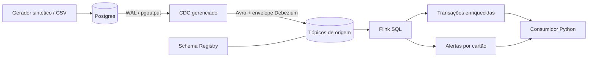

# Pagamentos em streaming

Pipeline de portfólio com **Postgres → CDC Debezium → Confluent Cloud → Flink SQL → consumidor Python**.
O Flink enriquece transações com a conta e identifica três compras do mesmo cartão em até 60 segundos.

**Estado da entrega em 15/10/2026:** implementação e simulação local validadas. **Ainda não executado no Confluent Cloud**: não foram disponibilizadas credenciais nem um Postgres acessível ao conector. Os testes locais não comprovam implantação, CDC ou execução do SQL no serviço. A entrega ainda precisa das evidências de nuvem descritas abaixo antes de ser submetida como pipeline funcionando.

Repositório: [Brunorsimas/Confluent-Cloud](https://github.com/Brunorsimas/Confluent-Cloud).
O nome existente foi preservado; para cumprir literalmente o requisito de nome em minúsculas, renomeie para `confluent-cloud` em Settings → General e atualize o remote.

## O caminho do dado



| Camada | Implementação | Escolha |
| --- | --- | --- |
| Fundação | `infra/`: ambiente isolado, Kafka Basic AWS us-east-2, Schema Registry Essentials, pool Flink de até 5 CFUs | Pequeno laboratório, configuração reproduzível e limite de capacidade explícito |
| Contrato | Avro no CDC; compatibilidade `FULL_TRANSITIVE`; teste contra o subject real | Mensagens tipadas e evolução verificada nos dois sentidos |
| Ingestão | `PostgresCdcSourceV2`, publication restrita, `REPLICA IDENTITY FULL` | CDC captura alterações confirmadas no WAL sem consultas batch recorrentes |
| Processamento | `sql/flink/`: envelope bruto para compras, changelog de contas, joins e `MATCH_RECOGNIZE` | Updates de status não contam como novas compras; janela acompanha o evento |
| Operação | Consumidor, verificador, teste negativo de ACL, métricas, custos e limpeza | Evidência por comando e encerramento explícito dos recursos |

O Terraform cria `payments-writer`, `payments-reader` e `payments-operator`.
O writer escreve nos tópicos `payments.public.*` e nos tópicos de preview exigidos pelo conector.
O reader lê apenas os dois tópicos de saída, com grupos `payments-reader-*`; não recebe permissão de escrita.
O operator tem `EnvironmentAdmin` no ambiente exclusivo e executa a infraestrutura/SQL. Essa identidade administrativa não é a do consumidor.
As credenciais do Kafka, Schema Registry e Flink são diferentes; os scripts leem os outputs em memória.

## Validação já executada

Saídas completas: [evidence/local-validation.txt](evidence/local-validation.txt).
Foram executados 20 testes de regra, contrato Avro, validação de CSV e leitura segura do `.env`, além da validação do provider Terraform 2.91.0.

```text
$ python -m unittest discover -s tests -v
Ran 20 tests in 0.070s
OK

$ terraform -chdir=infra validate -no-color
Success! The configuration is valid.

$ python -m pip check
No broken requirements found.
```

Saída real do gerador e da validação dos arquivos, executados localmente:

```text
$ python -m pipeline simulate
accounts: 3
transactions: 11
expected_alerts:
  card-boundary:card-boundary-3
  card-burst:card-burst-3
  card-burst:card-burst-4

$ python -m pipeline validate-data
{"accounts": 3, "transactions": 11, "valid": true}
```

O trecho do gerador acima foi reduzido para leitura; o JSON integral está em
[evidence/simulation.json](evidence/simulation.json). `expected_alerts` é a previsão do oráculo Python, não uma saída do Flink.

| Evidência de nuvem | Situação atual | Comando que a produz |
| --- | --- | --- |
| Ambiente, cluster e identidades | Não executado; falta acesso | `python -m pipeline foundation` |
| Aceitação/rejeição de schema no Registry | Não executado; testes Avro apenas locais | `python -m pipeline schema-test` |
| INSERT/UPDATE/DELETE e tombstone | Não executado; falta Postgres + conector | `python -m pipeline cdc-probe` |
| Jobs e resultados Flink | SQL preparado, sem validação pelo serviço | `python -m pipeline flink-status` e `python -m pipeline verify` |
| Consumo, ACL e métricas | Não executado | `consume`, `acl-test`, `metrics` |
| Cobrança real | Não disponível; nenhum recurso criado nesta execução | `costs` e exportação do Billing |

Não há prints fictícios, IDs inventados de recursos nem resultados locais apresentados como execução em nuvem.

## Preparar a máquina

Use Python 3.14, Git e Terraform 1.13.5. A CLI Confluent não é necessária: o projeto usa Terraform, APIs REST e o cliente Kafka oficial. Os comandos abaixo partem da raiz do repositório.

```powershell
git clone https://github.com/Brunorsimas/Confluent-Cloud.git
cd Confluent-Cloud
python -m venv .venv
.\.venv\Scripts\Activate.ps1
python -m pip install -r requirements.txt
Copy-Item .env.example .env
python -m pipeline doctor
```

No Linux/macOS, ative com `source .venv/bin/activate` e copie com `cp .env.example .env`.
Se a ativação no PowerShell estiver bloqueada, use `.\.venv\Scripts\python.exe` no lugar de `python`.
Se Terraform estiver fora do PATH, preencha `TERRAFORM` no `.env` com o caminho do executável.
`requirements.lock` fixa as dependências transitivas; `.terraform.lock.hcl` fixa o provider.

Preencha `.env` localmente com a Cloud API key/secret de uma identidade autorizada a criar ambiente, contas de serviço e role bindings. Use uma conta Confluent com faturamento/créditos habilitados. Nunca cole a chave no README ou em uma issue.

## Preparar o Postgres

O conector gerenciado roda na nuvem. **Ele não alcança o `localhost` da sua máquina.**
Use um Postgres de laboratório 17 com endpoint acessível ao Confluent Cloud, TLS e permissão de replicação lógica. Esse banco é um pré-requisito externo: o Terraform deste repositório não provisiona AWS RDS, rede ou certificados.

Uma opção é criar no console AWS uma instância RDS PostgreSQL 17 em `us-east-2`, banco inicial `payments`, com credenciais próprias. Associe um parameter group PostgreSQL 17 com `rds.logical_replication=1` e reinicie a instância. No security group, libere TCP 5432 apenas para seu IP e os endereços de saída do conector daquela região; a rede/subnet também precisa permitir o acesso. Não use `0.0.0.0/0`. Consulte os [requisitos de rede dos conectores](https://docs.confluent.io/cloud/current/connectors/networking/index.html) e a [preparação de Postgres para CDC](https://docs.confluent.io/cloud/current/connectors/cc-postgresql-cdc-source-v2-debezium/cc-postgresql-cdc-source-v2-debezium.html).

Em Postgres administrado por você, configure `wal_level=logical`, `max_replication_slots>=1`, `max_wal_senders>=1`, TLS e acesso no `pg_hba.conf`, e reinicie. O administrador informado em `PGUSER` precisa criar tabelas, publication e a role de replicação. `pg-init` reconhece RDS (`rds_replication`) e usa `REPLICATION` no Postgres comum.

Configure `PGHOST`, `PGPORT`, `PGDATABASE`, `PGUSER`, `PGPASSWORD`, `PGSSLMODE=require`, `CDC_USER=payments_cdc` e uma senha própria em `CDC_PASSWORD` no `.env`.

```powershell
python -m pipeline pg-init
python -m pipeline pg-health
```

Para estudar apenas a camada de banco localmente, há um Compose opcional:

```powershell
docker compose up -d --wait
```

Nesse modo, configure `POSTGRES_PASSWORD`, `PGHOST=127.0.0.1`, `PGUSER=payments_admin`, `PGPASSWORD` igual a `POSTGRES_PASSWORD` e `PGSSLMODE=disable`. Ele não habilita a execução Cloud: não há TLS público ou túnel configurado. Para o Cloud, volte às configurações do banco remoto.

## Subir uma camada por vez

**1. Fundação.** Reveja o plano antes do apply; esses comandos podem gerar cobrança real.

```powershell
python -m pipeline tf init
python -m pipeline tf validate
python -m pipeline tf plan
python -m pipeline tf apply
python -m pipeline foundation
```

O conector fica desabilitado nessa primeira etapa. O apply normal mantém a confirmação do Terraform e não usa `-auto-approve`.
O arquivo de state contém segredos mesmo com outputs marcados `sensitive`: não o publique, não anexe outputs `-json` brutos e não apague o state antes do destroy.

**2. Ingestão e dados sintéticos.** Comece com as tabelas vazias. Ative o conector antes da carga para que o cenário percorra o WAL como eventos `c`, na ordem de tempo.

```powershell
python -m pipeline tf plan -var=enable_connector=true
python -m pipeline tf apply -var=enable_connector=true
python -m pipeline connector-status
python -m pipeline simulate
python -m pipeline validate-data
python -m pipeline load
python -m pipeline cdc-probe
```

`connector-status` precisa mostrar conector e tarefas `RUNNING`; se estiver provisionando, espere e repita.
`simulate` cria 3 contas, 11 transações, cartões tokenizados, dinheiro em centavos e timestamps UTC. Não sobrescreve arquivos existentes. Se já executou a simulação local, reutilize os arquivos e pule esse comando. É possível escolher outra pasta com `--directory` nos três comandos de dados.

A carga valida a base inteira e insere em uma única transação, com as transações ordenadas por `occurred_at_ms`. Um ID já existente causa rollback, em vez de produzir updates silenciosos. Use um banco vazio para reproduzir os totais.
O conector registra os schemas Avro reais automaticamente quando escreve os primeiros eventos.

`cdc-probe` cria uma conta temporária baseada numa conta sintética existente, confirma insert, update e delete em commits distintos e exige os eventos `c`, `u`, `d` e o tombstone no Kafka. Também confere a mudança de `risk_tier` em `before/after`; a linha temporária é removida ao terminar. Não cria compras extras.

**3. Contrato.** Depois que o primeiro evento chegou:

```powershell
python -m pipeline schema-test
```

O comando lê `payments.public.transactions-value`, configura `FULL_TRANSITIVE`, adiciona `audit_tag` opcional com default `null`, verifica a compatibilidade e registra a versão. Depois testa uma troca incompatível de `op` de string para long e exige HTTP 409 ao tentar registrá-la. O schema não é uma cópia presumida do envelope: vem do próprio conector. Se houver HTTP 404, confira se a carga chegou ao Kafka antes de repetir.

**4. Flink e consumo.**

```powershell
python -m pipeline flink-deploy
python -m pipeline flink-status
python -m pipeline verify --seconds 180
python -m pipeline consume --seconds 90
```

O deploy envia os arquivos `01` a `08`, espera cada DDL completar e exige os dois INSERTs contínuos em `RUNNING`. Reexecuções aproveitam statements de mesmo nome e SQL; SQL alterado exige remoção deliberada do statement correspondente no console. Não remova DDLs concluídos para reaplicar tudo no mesmo catálogo: a coluna calculada já existirá. Para reproduzir integralmente, destrua e recrie o ambiente.

`verify` lê os dois tópicos desde o início com um grupo novo, materializa os upserts e exige exatamente 3 alertas e 11 transações enriquecidas, incluindo as trincas esperadas e nomes das contas. Um timeout sem dados é falha, nunca sucesso. O consumidor normal grava em `.runtime/consumed.jsonl`, força a persistência e só então confirma o offset. Se houver falha entre persistência e commit, pode repetir a linha; deduplique por tópico/partição/offset e aplique os resultados pela chave.

Se o consumidor normal não mostrar nada em uma segunda execução, ele pode já ter confirmado os offsets. Use um grupo novo, por exemplo `--group payments-reader-review-2`, para reler. A API key do reader não acessa os tópicos de origem.

## Como a regra se comporta

O tempo é `occurred_at_ms` da compra, não o horário de chegada ao broker. O watermark permite 5 segundos de desordem. A regra acompanha trincas consecutivas do mesmo cartão e exige diferença entre primeira e terceira de **no máximo 60 segundos**. Não usa janelas fixas por minuto, que perderiam compras na fronteira.

`AFTER MATCH SKIP TO NEXT ROW` permite sobreposição: quatro compras próximas produzem dois alertas, identificados pela terceira compra de cada trinca. O `WITHIN 61s` limita o estado do padrão; a condição explícita de `C` limita a regra a 60s inclusivos, evitando expiração na borda exata.

| Caso sintético | Tempos relativos | Resultado previsto |
| --- | --- | --- |
| `card-burst` | 50s, 70s, 100s, 105s | 2 alertas |
| `card-boundary` | 10s, 40s, 70s | 1 alerta |
| `card-outside` | 10s, 40s, 70,001s | 0 alertas |
| `card-advance` | 180s | 0 alertas; faz o watermark avançar no replay finito |

A leitura de transações usa Avro bruto para preservar o envelope e filtra `op IN ('c','r')`. Updates, deletes e tombstones continuam no tópico de auditoria, mas não contam como novas tentativas de compra e não cancelam alertas históricos. O campo de status na saída se chama `status_at_creation` por esse motivo.

Contas usam o changelog Debezium completo. O enriquecimento é um **join com o estado atual da conta**, não uma consulta histórica da conta no instante da compra. Mudanças na conta atualizam os resultados por upsert; uma conta ainda ausente produz campos nulos e pode ser enriquecida depois. A chave estável do alerta permite ao consumidor substituir esse resultado sem tratá-lo como um alerta novo. A conta apresentada no alerta é a da terceira transação.

Limites do laboratório: o oráculo Python ordena uma entrada finita e não simula watermarks. Ele não prova o comportamento de eventos atrasados no Flink. Eventos além do watermark podem ficar fora da detecção. O conector usa sua entrega padrão; não há garantia end-to-end de ausência de duplicatas após falhas ou snapshots reiniciados. A comparação de IDs evita contar a mesma compra três vezes na mesma trinca, mas não substitui deduplicação durável da origem.

Os joins mantêm estado sem TTL para não perder o enriquecimento de contas pouco alteradas. Isso precisa de revisão de capacidade em um serviço permanente. A origem retém sete dias: refazer o processamento depois disso exige novo snapshot/backup. Os tópicos de saída são compactados; a retenção de sete dias configurada não é um prazo de expiração para compactação pura. Destruir o cluster remove esses tópicos.

## Operação e custo

```powershell
python -m pipeline pg-health
python -m pipeline connector-status
python -m pipeline flink-status
python -m pipeline acl-test
python -m pipeline metrics
```

`acl-test` exige uma negação real do broker ao reader tentar ler a origem; erros de rede ou timeout não contam como sucesso. A leitura positiva é comprovada por `verify`/`consume`.
`metrics` consulta bytes recebidos/enviados nos últimos 15 minutos, com margem de 5 minutos para atraso de publicação; exige Cloud API key com acesso de monitoração. Resposta vazia é registrada, mas o comando falha para não apresentá-la como prova de tráfego.

No console, acompanhe também consumer lag, utilização/limite de CFU, reinícios e tarefas do conector. No Postgres, `pg-health` mostra se o slot está ativo e o WAL retido. Tarefas FAILED, lag crescente ou WAL acumulado pedem investigação antes de nova carga. Um valor de bytes sozinho não comprova latência ou saúde de ponta a ponta.

**Custo observado nesta execução:** nenhum recurso Cloud foi provisionado; não existe cobrança Cloud medida deste pipeline. Isso não significa que rodar o projeto na nuvem seja gratuito. Não há estimativa numérica apresentada como fatura.

Para medir uma execução, anote início/fim em UTC, salve o export do Billing filtrado pelos recursos do laboratório e inclua Kafka, armazenamento/tráfego, conector, CFU-h do Flink, governança quando cobrada e o Postgres/rede externo. Normalize as linhas cobradas para CSV com cabeçalho:

```csv
service,quantity,unit,unit_price,currency
```

```powershell
python -m pipeline costs evidence/private/billing-normalized.csv
```

O script soma quantidade × tarifa com `Decimal`, rejeita tabela vazia ou mistura de moedas. Ele não consulta preços nem supõe créditos gratuitos. Guarde o export original e registre créditos/impostos separadamente: o cálculo representa os itens brutos fornecidos, não necessariamente o total líquido da fatura. O limite de CFU é de capacidade, não um teto monetário. Pausar um job não elimina custos de cluster, armazenamento e banco.

## Derrubar o laboratório

Pare/remova os statements antes do pool; exclua o conector antes do slot. Os comandos abaixo removem os recursos Cloud deste state e preservam as tabelas do Postgres.

```powershell
python -m pipeline flink-delete
python -m pipeline tf apply -var=enable_connector=false
python -m pipeline pg-cleanup
python -m pipeline tf destroy
```

Revise o plano de destroy. Ele inclui ambiente, cluster, tópicos de origem/saída, schemas do ambiente, pool, identidades, bindings e chaves gerenciados pelo projeto. Preserve as evidências antes. Se `pg-cleanup` disser slot ativo, confirme que o conector foi realmente excluído e repita. Remova também o banco RDS e recursos externos criados para este laboratório no provedor, decidindo conscientemente se precisa de snapshot final. O Terraform Confluent não os remove.

Para o banco local opcional, `docker compose down` mantém os dados. `docker compose down -v` apaga o volume do laboratório. Não use a segunda forma se precisar preservar os dados.

## Evidências para publicar

Os comandos gravam saídas em `evidence/private/`, ignorada pelo Git. Revise cada arquivo antes de copiar resultados para uma pasta pública de evidências e atualizar a tabela de situação deste README. Nunca publique `.env`, state, planos Terraform, dumps de credenciais, senhas ou chaves. Os testes de unidade e o gerador estão separados dos comandos que realmente precisam do Cloud.

Para repetir as verificações locais:

```powershell
python -m pipeline tf init -backend=false
python scripts/verify_local.py
```

O workflow `.github/workflows/validate.yml` faz testes Python e validação Terraform sem segredos de nuvem. Não executa deploy.
Antes da submissão final, ainda é necessário executar as cinco camadas no serviço, publicar suas evidências e custo real, conferir a reprodução completa e o nome em minúsculas. Envie o link da raiz do repositório público.

## Referências técnicas

- [Provider Terraform Confluent e exemplo Flink](https://github.com/confluentinc/terraform-provider-confluent/tree/master/examples/configurations/flink-quickstart)
- [PostgreSQL CDC V2](https://docs.confluent.io/cloud/current/connectors/cc-postgresql-cdc-source-v2-debezium/cc-postgresql-cdc-source-v2-debezium.html)
- [Serialização e envelope Debezium no Flink](https://docs.confluent.io/cloud/current/flink/reference/serialization.html)
- [MATCH_RECOGNIZE](https://docs.confluent.io/cloud/current/flink/reference/queries/match_recognize.html)
- [Opções de tabelas no Flink Cloud](https://docs.confluent.io/cloud/current/flink/reference/statements/create-table.html)
- [API de statements Flink](https://docs.confluent.io/cloud/current/flink/operate-and-deploy/flink-rest-api.html)
