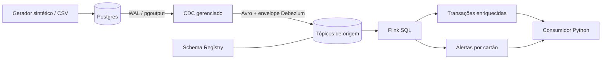

# Pipeline de pagamentos com CDC e detecção de fraude

O projeto foi desenvolvido para capturar alterações de pagamentos no Postgres, processá-las em streaming e disponibilizar transações enriquecidas e alertas de possível fraude. A solução foi organizada em cinco camadas: infraestrutura, contrato de dados, ingestão, processamento e operação.

O fluxo utiliza **Postgres, CDC Debezium, Confluent Cloud, Flink SQL e um consumidor Python**. A regra de negócio identifica três transações consecutivas do mesmo cartão em um intervalo de até 60 segundos. Os dados utilizados são sintéticos, com geração reproduzível e cenários positivos e negativos para a detecção.

Repositório: [Brunorsimas/Confluent-Cloud](https://github.com/Brunorsimas/Confluent-Cloud).

## Objetivo e escopo

A solução demonstra o caminho de uma alteração confirmada no banco até seu consumo em um sistema de streaming. O processamento preserva os eventos de origem, associa as transações aos dados das contas e publica resultados com chaves estáveis para atualização pelos consumidores.

A implementação contempla infraestrutura como código, identidades com permissões distintas, contratos Avro, captura de insert, update e delete, enriquecimento em Flink SQL, detecção de padrões por cartão e ferramentas de verificação operacional. O banco Postgres, sua rede e seus certificados são dependências externas à infraestrutura Confluent definida neste repositório.

## Arquitetura da solução



| Camada | Implementação | Decisão técnica |
| --- | --- | --- |
| Fundação | Ambiente isolado, Kafka Basic na AWS us-east-2, Schema Registry Essentials e pool Flink com limite padrão de 5 CFUs | Infraestrutura reproduzível, dimensionada para um laboratório e descrita em Terraform |
| Contrato | Serialização Avro e teste de evolução com `FULL_TRANSITIVE` no subject do CDC | Verificação de compatibilidade entre versões do schema nos dois sentidos |
| Ingestão | Conector `PostgresCdcSourceV2`, publication restrita e `REPLICA IDENTITY FULL` | Captura das alterações confirmadas no WAL, incluindo os valores anteriores necessários ao changelog |
| Processamento | Flink SQL com leitura do envelope CDC, joins e `MATCH_RECOGNIZE` | Enriquecimento das transações e identificação de padrões pelo horário do evento |
| Operação | Consumidor Python, verificação de resultados, teste de ACL, métricas e apuração de custos | Procedimentos para conferir o fluxo e administrar seu ciclo de vida |

Foi adotado CDC para acompanhar as alterações do banco sem depender de extrações batch periódicas. O envelope Debezium mantém a operação e os estados anterior e posterior do registro, permitindo distinguir uma nova transação de uma alteração de status.

O Flink concentra o enriquecimento e a regra de fraude em SQL. A detecção usa sequências de eventos por cartão, evitando que a virada de um minuto divida transações que pertencem ao mesmo intervalo de 60 segundos.

### Organização do repositório

| Caminho | Responsabilidade |
| --- | --- |
| `infra/` | Ambiente Confluent, cluster, Schema Registry, pool Flink, identidades, permissões e conector |
| `connectors/postgres.json` | Configuração do CDC gerenciado |
| `sql/postgres/` | Tabelas, publication, verificação de saúde e limpeza da replicação |
| `sql/flink/` | Configuração das fontes, tabelas de saída, enriquecimento e regra de fraude |
| `pipeline/` | Comandos Python de simulação, carga, implantação, consumo, validação e operação |
| `tests/` | Testes locais da regra, dos dados, do contrato Avro e da leitura do ambiente |
| `evidence/` | Registros públicos das validações executadas |
| `.github/workflows/validate.yml` | Verificação automática dos testes Python e da configuração Terraform |

## Modelo e contrato dos dados

A origem foi modelada em duas tabelas relacionadas por `account_id`.

| Entidade | Campos | Restrições principais |
| --- | --- | --- |
| `accounts` | `account_id`, `account_name`, `country`, `risk_tier` | Chave primária em `account_id`; país com dois caracteres; risco `low`, `medium` ou `high` |
| `transactions` | `transaction_id`, `account_id`, `card_token`, `amount_minor`, `currency`, `occurred_at_ms`, `status` | Chave primária em `transaction_id`; referência à conta; valor e timestamp positivos; moeda com três caracteres |

Os valores monetários são armazenados como inteiros na menor unidade da moeda: centavos para BRL. O campo `occurred_at_ms` representa Unix epoch em milissegundos UTC. Os cartões são identificados por tokens sintéticos. Os status aceitos são `pending`, `approved`, `declined` e `refunded`.

A carga valida os CSVs antes de gravar, rejeita IDs duplicados, contas inexistentes e valores fora do contrato. A inserção ocorre em uma única transação, com os pagamentos ordenados por `occurred_at_ms`. Se um ID já existir no banco, a operação faz rollback.

### Tópicos e saídas

| Tópico | Conteúdo | Tratamento |
| --- | --- | --- |
| `payments.public.accounts` | Alterações das contas no envelope Debezium | Changelog completo para refletir o estado atual da conta |
| `payments.public.transactions` | Alterações das transações no envelope Debezium | Preservação da origem e seleção de novas transações para a regra |
| `payments.transactions_enriched` | Transações associadas ao nome, país e risco da conta | Upsert por `transaction_id` |
| `payments.fraud_alerts` | Trincas suspeitas, intervalo dos eventos, regra e dados da conta | Upsert por `alert_id` |

O conector registra automaticamente os schemas Avro quando publica os primeiros eventos. O teste de evolução utiliza o subject `payments.public.transactions-value` e configura `FULL_TRANSITIVE`.

Foram implementados dois cenários de contrato: inclusão de `audit_tag` opcional com default `null`, cuja versão deve ser aceita, e alteração de `op` de string para long, cujo registro deve ser recusado com HTTP 409. O teste consulta o schema produzido pelo próprio conector. Uma resposta HTTP 404 indica que é necessário verificar a existência do subject e a chegada dos eventos.

## Ingestão por CDC

O conector foi configurado com `snapshot.mode=initial`, publication `payments_publication`, slot `payments_cdc`, chave e valor em Avro e emissão de tombstones. A captura é restrita às tabelas `public.accounts` e `public.transactions`, com uma tarefa e `errors.tolerance=none`.

As tabelas usam `REPLICA IDENTITY FULL` para disponibilizar os valores anteriores em updates e deletes. O comando `cdc-probe` verifica esse comportamento com uma conta temporária baseada em uma conta sintética existente: executa insert, update e delete em commits separados, busca os eventos `c`, `u`, `d` e o tombstone no Kafka e confere a alteração de `risk_tier` em `before/after`. A conta temporária é removida ao final, sem gerar pagamentos adicionais.

Para reproduzir a carga como eventos de criação, o procedimento de implantação ativa o conector com as tabelas vazias antes de inserir a base sintética.

## Processamento e regra de fraude

### Enriquecimento

O enriquecimento foi implementado como um join entre as transações de criação e o changelog completo das contas. O resultado apresenta os dados do **estado atual da conta**. Uma atualização na conta pode atualizar os resultados por upsert; uma conta ainda ausente produz campos nulos, que podem ser preenchidos quando seus dados chegarem.

Essa escolha permite acompanhar alterações cadastrais, mas não reconstrói a conta como ela era no instante da compra. Nos alertas, a conta apresentada é a da terceira transação da sequência. A chave estável permite atualizar os dados do alerta no consumidor.

### Critério de detecção

A regra `three-per-card-60s-v1` considera três transações consecutivas com IDs distintos e o mesmo `card_token`. A diferença entre o horário da primeira e o da terceira deve ser de **no máximo 60 segundos**, incluindo o limite exato.

O processamento usa o horário de negócio em `occurred_at_ms`, convertido para tempo de evento, com watermark de 5 segundos. A ordenação considera o tempo do evento e o identificador da transação como desempate.

A leitura em Avro bruto preserva o envelope, e o filtro `op IN ('c','r')` seleciona inserts e registros do snapshot. Updates, deletes e tombstones permanecem na origem, mas não contam como novas transações e não cancelam alertas históricos. Por essa razão, o status publicado no enriquecimento se chama `status_at_creation`.

O padrão foi escrito com `MATCH_RECOGNIZE` e `AFTER MATCH SKIP TO NEXT ROW`, permitindo trincas sobrepostas. Quatro transações próximas podem gerar dois alertas. O identificador de cada alerta combina o cartão com a terceira transação da trinca.

O `WITHIN 61s` limita o tempo de retenção do padrão em aberto. A condição explícita de `C` mantém a regra em 60 segundos inclusivos; o segundo adicional evita que o padrão expire na borda exata do intervalo.

### Cenários de referência

A simulação gera 3 contas e 11 transações. A base inclui compras que cruzam a virada do minuto, uma ocorrência no limite exato, uma fora da janela e um evento posterior para avançar o watermark durante o replay finito.

| Caso sintético | Tempos relativos | Resultado esperado |
| --- | --- | --- |
| `card-burst` | 50s, 70s, 100s, 105s | 2 alertas |
| `card-boundary` | 10s, 40s, 70s | 1 alerta |
| `card-outside` | 10s, 40s, 70,001s | 0 alertas |
| `card-advance` | 180s | 0 alertas; avanço do watermark |

## Segurança e controle de acesso

Foram definidas três identidades com responsabilidades distintas:

| Identidade | Acesso definido |
| --- | --- |
| `payments-writer` | Escrita em `payments.public.*` e nos tópicos de preview exigidos pelo conector |
| `payments-reader` | Leitura dos dois tópicos de saída, com grupos `payments-reader-*`, sem permissão de escrita |
| `payments-operator` | Administração da infraestrutura e execução de SQL, com `EnvironmentAdmin` no ambiente exclusivo |

Kafka, Schema Registry e Flink utilizam credenciais próprias, lidas pelos scripts a partir dos outputs Terraform em memória. A configuração local fica no `.env`, e o arquivo versionado de referência é `.env.example`.

O state Terraform contém segredos mesmo com outputs marcados como `sensitive`. O state, os planos, os outputs brutos em `-json`, as senhas e as chaves devem permanecer fora do repositório público. O state precisa ser preservado até a remoção dos recursos.

## Validação e evidências

A validação registrada em 15/10/2026 compreende **20 testes locais aprovados**, verificação das dependências e validação da configuração Terraform com o provider Confluent 2.91.0. A saída completa está em [evidence/local-validation.txt](evidence/local-validation.txt).

Os testes cobrem a regra de fraude, os limites da janela, a separação por cartão, as trincas sobrepostas, o tratamento das operações CDC, a evolução Avro, a validação dos CSVs e a leitura literal do `.env`.

```text
$ python -m unittest discover -s tests -v
Ran 20 tests in 0.070s
OK

$ terraform -chdir=infra validate -no-color
Success! The configuration is valid.

$ python -m pip check
No broken requirements found.
```

O gerador e a validação dos arquivos produziram os seguintes resultados. A saída foi resumida; o JSON integral está em [evidence/simulation.json](evidence/simulation.json).

```text
$ python -m pipeline simulate
accounts: 3
transactions: 11
expected_alerts:
  card-boundary:card-boundary-3
  card-burst:card-burst-3
  card-burst:card-burst-4

$ python -m pipeline validate-data
{"accounts": 3, "transactions": 11, "valid": true}
```

O campo `expected_alerts` é calculado pelo script de referência Python. As evidências disponíveis comprovam a simulação e a validação local; **a implantação e a execução de ponta a ponta no Confluent Cloud não foram registradas nesta validação**. O script de referência ordena uma base finita e não simula watermarks.

### Critérios de aceite da execução integrada

| Verificação | Critério de aceite | Comando |
| --- | --- | --- |
| Fundação | Identificação do ambiente, cluster, pool e contas de serviço provisionados | `python -m pipeline foundation` |
| Contrato | Campo opcional aceito e mudança incompatível recusada pelo Registry | `python -m pipeline schema-test` |
| CDC | Eventos de insert, update, delete e tombstone, com alteração conferida em `before/after` | `python -m pipeline cdc-probe` |
| Processamento | Statements no estado previsto, 3 alertas e 11 transações enriquecidas | `python -m pipeline flink-status` e `python -m pipeline verify` |
| Consumo e acesso | Leitura das saídas e negação do acesso do reader à origem | `consume` e `acl-test` |
| Monitoração | Amostras de tráfego disponíveis para o cluster | `metrics` |
| Custos | Itens faturados associados à execução e total apurado | `costs` e exportação do Billing |

O workflow `.github/workflows/validate.yml` executa os testes Python e a validação Terraform sem credenciais de nuvem ou deploy. As verificações locais podem ser repetidas com:

```powershell
python -m pipeline tf init -backend=false
python scripts/verify_local.py
```

## Procedimento de implantação

### Requisitos e configuração local

O ambiente de referência utiliza Python 3.14, Git e Terraform 1.13.5. O acesso ao Confluent Cloud é realizado pelas APIs REST e pelo cliente Kafka oficial; a CLI Confluent é dispensável. Os comandos devem ser executados na raiz do repositório.

```powershell
git clone https://github.com/Brunorsimas/Confluent-Cloud.git
cd Confluent-Cloud
python -m venv .venv
.\.venv\Scripts\Activate.ps1
python -m pip install -r requirements.txt
Copy-Item .env.example .env
python -m pipeline doctor
```

No Linux/macOS, a ativação é `source .venv/bin/activate` e a cópia do arquivo é `cp .env.example .env`. Se a ativação estiver bloqueada no PowerShell, utilize `.\.venv\Scripts\python.exe` no lugar de `python`. Quando o Terraform estiver fora do PATH, informe seu caminho em `TERRAFORM`, no `.env`.

As dependências transitivas estão fixadas em `requirements.lock`, e o provider em `.terraform.lock.hcl`. A conta Confluent deve ter faturamento ou créditos habilitados. A Cloud API key e o secret configurados no `.env` precisam pertencer a uma identidade autorizada a criar ambientes, contas de serviço e role bindings.

### Preparação do Postgres

O banco de referência é Postgres 17, com TLS, replicação lógica e endpoint acessível ao conector gerenciado no Confluent Cloud. **O conector não acessa o `localhost` da máquina de desenvolvimento.** Banco, rede e certificados são preparados separadamente do Terraform Confluent.

Uma opção de hospedagem é RDS PostgreSQL 17 na AWS `us-east-2`, com banco inicial `payments`, credenciais próprias e parameter group com `rds.logical_replication=1`. A alteração requer reinício da instância. O security group deve permitir TCP 5432 apenas para o IP de administração e os endereços de saída do conector na região, com rede e subnet compatíveis. Evite a abertura para `0.0.0.0/0`.

Para Postgres administrado diretamente, configure `wal_level=logical`, `max_replication_slots>=1`, `max_wal_senders>=1`, TLS e acesso no `pg_hba.conf`, e reinicie o servidor. O usuário em `PGUSER` precisa ter permissão para criar tabelas, publication e role de replicação. O `pg-init` utiliza `rds_replication` no RDS e `REPLICATION` no Postgres comum.

Preencha `PGHOST`, `PGPORT`, `PGDATABASE`, `PGUSER`, `PGPASSWORD`, `PGSSLMODE=require`, `CDC_USER=payments_cdc` e uma senha própria em `CDC_PASSWORD` no `.env`. Execute a criação das tabelas e a verificação de saúde:

```powershell
python -m pipeline pg-init
python -m pipeline pg-health
```

Os requisitos específicos estão na documentação de [rede dos conectores](https://docs.confluent.io/cloud/current/connectors/networking/index.html) e de [preparação de Postgres para CDC](https://docs.confluent.io/cloud/current/connectors/cc-postgresql-cdc-source-v2-debezium/cc-postgresql-cdc-source-v2-debezium.html).

O repositório também fornece um Compose para uso local do banco:

```powershell
docker compose up -d --wait
```

Nesse modo, configure `POSTGRES_PASSWORD`, `PGHOST=127.0.0.1`, `PGUSER=payments_admin`, `PGPASSWORD` igual a `POSTGRES_PASSWORD` e `PGSSLMODE=disable`. Esse ambiente atende aos testes locais de Postgres; o Compose não configura TLS público ou túnel para o conector Cloud. Para a execução integrada, utilize a configuração do banco remoto.

### Provisionamento da infraestrutura

A primeira aplicação cria a fundação com o conector desabilitado. O plano deve ser revisado antes da confirmação, pois o provisionamento pode gerar cobrança.

```powershell
python -m pipeline tf init
python -m pipeline tf validate
python -m pipeline tf plan
python -m pipeline tf apply
python -m pipeline foundation
```

O procedimento mantém a confirmação padrão do Terraform, sem `-auto-approve`.

### Ativação do CDC e carga

Com as tabelas vazias, habilite o conector e aguarde conector e tarefas em `RUNNING` antes da carga. Durante o provisionamento, repita a consulta de status até esse estado ser alcançado.

```powershell
python -m pipeline tf plan -var=enable_connector=true
python -m pipeline tf apply -var=enable_connector=true
python -m pipeline connector-status
python -m pipeline simulate
python -m pipeline validate-data
python -m pipeline load
python -m pipeline cdc-probe
```

O `simulate` preserva arquivos existentes. Caso a base já tenha sido gerada, reutilize os arquivos e omita esse comando. Os comandos de simulação, validação e carga aceitam outra pasta pelo parâmetro `--directory`. A reprodução dos totais exige um banco sem registros anteriores dessa base.

### Evolução do schema

Após a publicação dos primeiros eventos e o registro do subject, execute o teste de contrato:

```powershell
python -m pipeline schema-test
```

### Implantação do Flink e consumo

O deploy envia os arquivos `01` a `08` em sequência, aguarda a conclusão dos DDLs e verifica se os dois INSERTs contínuos estão em `RUNNING`.

```powershell
python -m pipeline flink-deploy
python -m pipeline flink-status
python -m pipeline verify --seconds 180
python -m pipeline consume --seconds 90
```

Statements com o mesmo nome e SQL são reaproveitados em uma reexecução. Uma alteração no SQL exige a remoção do statement correspondente no console antes do reenvio. A exclusão de um statement DDL não desfaz os objetos criados: reaplicar o comando de coluna calculada no mesmo catálogo pode falhar porque a coluna já existe. Para reproduzir toda a montagem, remova e recrie o ambiente.

O `verify` utiliza um grupo novo, lá os dois tópicos desde o início e materializa os upserts. O aceite exige exatamente 3 alertas e 11 transações enriquecidas, com os identificadores esperados e os nomes das contas. A ausência de dados no prazo causa falha na verificação.

## Operação e monitoração

### Consumo e confirmação de offsets

O consumidor grava em `.runtime/consumed.jsonl`, força a persistência e somente depois confirma o offset. Uma falha entre a gravação e o commit pode repetir uma linha na próxima leitura. A deduplicação do log deve considerar tópico, partição e offset; os resultados devem ser aplicados pela chave do registro.

Uma segunda execução com o mesmo grupo pode não retornar mensagens se os offsets já tiverem sido confirmados. Para reler, utilize um grupo novo, como `--group payments-reader-review-2`. A identidade reader tem acesso aos tópicos de saída; a origem permanece restrita.

### Verificações operacionais

```powershell
python -m pipeline pg-health
python -m pipeline connector-status
python -m pipeline flink-status
python -m pipeline acl-test
python -m pipeline metrics
```

O `acl-test` espera uma negação explícita do broker ao tentar ler a origem com a identidade reader. Erros de rede e timeout não atendem ao critério de aceite. A leitura autorizada das saídas é verificada por `verify`/`consume`.

O comando `metrics` consulta bytes recebidos e enviados em um intervalo de 15 minutos, com margem de 5 minutos para o atraso da telemetria. É necessária uma Cloud API key com acesso de monitoração. Respostas sem amostras são registradas e causam falha no comando.

A análise operacional considera consumer lag, uso e limite de CFU, reinícios e estado das tarefas do conector. O `pg-health` informa a atividade do slot e o volume de WAL retido. Tarefas FAILED, crescimento de lag ou acúmulo de WAL devem ser investigados antes de novas cargas. As métricas de tráfego precisam ser avaliadas em conjunto com esses indicadores para analisar latência e continuidade do fluxo.

### Gestão das evidências

Os comandos gravam suas saídas em `evidence/private/`, pasta ignorada pelo Git. A publicação das evidências requer revisão dos arquivos e cópia dos registros apropriados para uma pasta pública. Arquivos `.env`, state, planos Terraform, dumps de credenciais, senhas e chaves ficam fora dessa publicação.

## Apuração de custos

O custo da execução em nuvem não foi medido na validação disponível, pois não houve provisionamento de recursos Cloud nessa execução. A documentação de custos define o procedimento de apuração, sem atribuir um valor de fatura a resultados locais.

A medição considera início e fim em UTC e exportação do Billing filtrada pelos recursos do projeto. Devem ser incluídos Kafka, armazenamento, tráfego, conector, CFU-h do Flink, governança quando cobrada e os custos externos de Postgres e rede. Os itens são normalizados em um CSV com o seguinte cabeçalho:

```csv
service,quantity,unit,unit_price,currency
```

```powershell
python -m pipeline costs evidence/private/billing-normalized.csv
```

O cálculo utiliza `Decimal` para somar quantidade × tarifa. O script rejeita arquivos vazios ou com moedas diferentes; as tarifas vêm dos dados fornecidos e não são consultadas automaticamente. A exportação original deve ser preservada, com créditos e impostos registrados separadamente. O total calculado representa os itens brutos informados e pode diferir do valor líquido da fatura.

O limite de CFU controla a capacidade do pool, sem estabelecer um teto monetário. A pausa dos jobs não elimina possíveis cobranças de cluster, armazenamento e banco.

## Encerramento do ambiente

A remoção segue a ordem de dependência: statements antes do pool, conector antes do slot e infraestrutura após a limpeza da replicação. A sequência preserva as tabelas do Postgres.

```powershell
python -m pipeline flink-delete
python -m pipeline tf apply -var=enable_connector=false
python -m pipeline pg-cleanup
python -m pipeline tf destroy
```

As evidências devem ser salvas antes do destroy. O plano inclui ambiente, cluster, tópicos de origem e saída, schemas do ambiente, pool, identidades, bindings e chaves gerenciados pelo projeto. Se o `pg-cleanup` encontrar um slot ativo, verifique a exclusão do conector antes de repetir.

O banco RDS e os demais recursos externos devem ser removidos no provedor de origem, com decisão sobre a necessidade de um snapshot final. Esses recursos não são gerenciados pelo Terraform Confluent.

No banco local, `docker compose down` encerra os containers e mantém os dados. `docker compose down -v` também remove o volume do laboratório e deve ser utilizado apenas quando os dados puderem ser descartados.

## Limites de uso

A implementação utiliza a garantia de entrega padrão do conector. Falhas ou reinício de snapshots podem gerar duplicatas; a comparação de IDs nas trincas não substitui deduplicação durável na origem nem estabelece garantia de ausência de duplicação de ponta a ponta.

Eventos que chegam depois do watermark podem ficar fora da detecção. Os testes locais não exercitam esse comportamento no serviço Flink. Os joins mantém estado sem TTL para preservar o enriquecimento de contas pouco alteradas, o que exige avaliação de capacidade para uso permanente.

Os tópicos de origem retêm sete dias de eventos. Reprocessamentos de períodos anteriores dependem de novo snapshot ou backup. Os tópicos de saída usam compactação pura: os sete dias configurados não representam um prazo de expiração dos registros. A remoção do cluster elimina esses tópicos.

## Referências técnicas

- [Provider Terraform Confluent e exemplo Flink](https://github.com/confluentinc/terraform-provider-confluent/tree/master/examples/configurations/flink-quickstart)
- [PostgreSQL CDC V2](https://docs.confluent.io/cloud/current/connectors/cc-postgresql-cdc-source-v2-debezium/cc-postgresql-cdc-source-v2-debezium.html)
- [Serialização e envelope Debezium no Flink](https://docs.confluent.io/cloud/current/flink/reference/serialization.html)
- [MATCH_RECOGNIZE](https://docs.confluent.io/cloud/current/flink/reference/queries/match_recognize.html)
- [Opções de tabelas no Flink Cloud](https://docs.confluent.io/cloud/current/flink/reference/statements/create-table.html)
- [API de statements Flink](https://docs.confluent.io/cloud/current/flink/operate-and-deploy/flink-rest-api.html)
